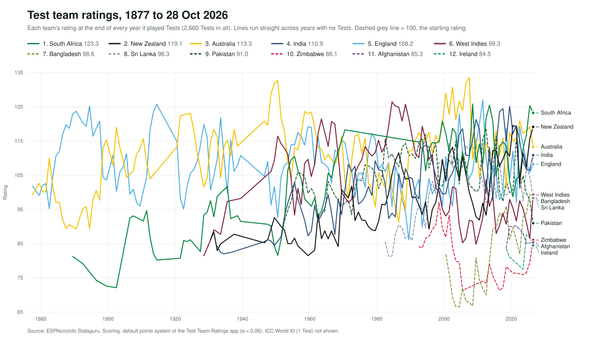
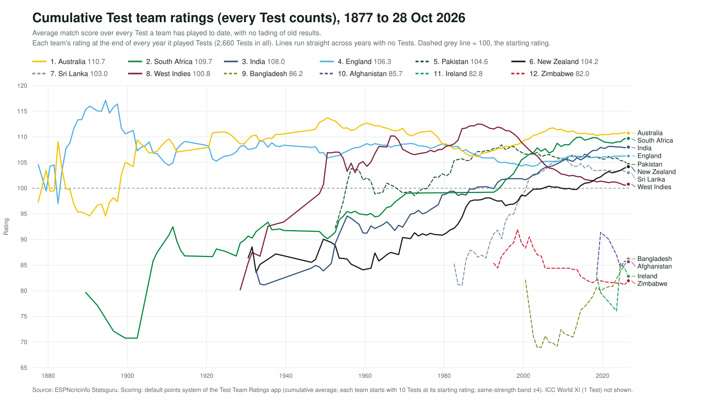

# Test Team Ratings

Ratings for every men's Test cricket team, worked out Test by Test from the first Test (Melbourne, March 1877) to the latest finished one.

**Live app:** https://sameerumralkar.github.io/test-cricket-ratings/

## How a Test is scored

Each team's points for a Test = **result points × venue multiplier × opposition multiplier**.

| Result type (first that fits) | Win | Loss |
|---|---|---|
| After follow-on (won after following on / lost after enforcing it) | +24 | −24 |
| By an innings | +16 | −16 |
| Big margin: more than 300 runs, or 9–10 wickets | +14 | −14 |
| Close: under 30 runs, or 2 wickets or fewer | +9 | −6 |
| Every other win or loss | +12 | −12 |

Draw: 0 at home, +1 neutral, +2 away. Tie: +4 each. Abandoned: no effect.

| Venue | Credit | Penalty |   | Opposition | Credit | Penalty |
|---|---|---|---|---|---|---|
| Home | ×1.0 | ×1.2 | | Stronger | ×1.4 | ×0.7 |
| Neutral | ×1.2 | ×1.0 | | Same | ×1.0 | ×1.0 |
| Away | ×1.4 | ×0.8 | | Weaker | ×0.7 | ×1.4 |

Opposition strength compares the two sides' ratings before the Test (same strength = within ±8, or ±4 for the all-Tests rating).

A Test's match score is `100 + 4 × points`. Two rating types:

- **Current form:** `new = old + 0.06 × (score − old)`. Recent Tests count most; a team drops out of the rankings after 4 years without a Test.
- **All Tests to date:** the average match score over every Test the team has played, cushioned by 10 Tests at its starting rating. Nothing fades.

England and Australia start at 100, later teams at 85. Every value can be changed in the app's Points system tab.

## Charts

| | |
|---|---|
|  |  |

One panel per team: [dist/ratings_history.svg](dist/ratings_history.svg)

## Updating

```sh
./update.sh                                  # re-fetch every result and rebuild dist/index.html
python3 scripts/plot_combined.py             # combined chart, current form
python3 scripts/plot_combined.py cumulative  # combined chart, all Tests to date
python3 scripts/plot_history.py              # one panel per team
```

- `scripts/fetch_results.py` downloads all Test results from ESPNcricinfo Statsguru (home, away and neutral team results, plus the innings view to detect follow-ons) into `data/matches.json`. Tests still in progress are skipped.
- `scripts/build.py` embeds the data and `data/team_colors.json` into `app/template.html`, producing `dist/index.html`.
- `scripts/ratings_engine.py` is the Python version of the rating engine, used by the chart scripts.

Pushing changes under `dist/` redeploys the site via GitHub Actions.

Data: [ESPNcricinfo Statsguru](https://stats.espncricinfo.com/ci/engine/stats/index.html?class=1;template=results;type=team). Requires Python 3.9+, no third-party packages.
